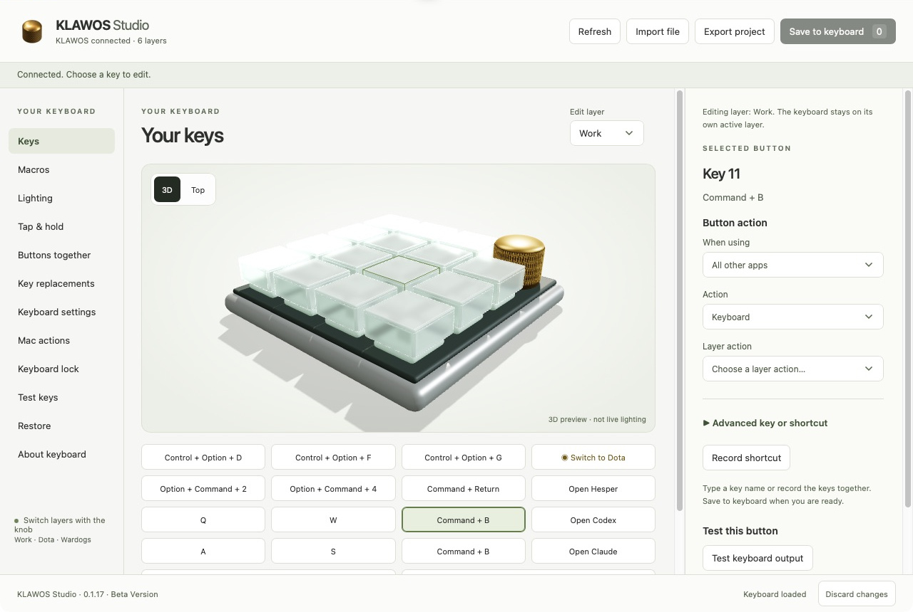

# KLAWOS Studio

A Mac app for setting up your KLAWOS keys, shortcuts, macros, lighting and app actions.

**Beta Version · Apple Silicon · macOS 14 or later**

## Make the buttons work your way

- **Keys and shortcuts:** select a button, record a shortcut and save it to the keyboard.
- **Mac actions:** open an app, bring it to the front or choose a named action for apps such as ChatGPT and Claude.
- **Macros and advanced keys:** edit sequences, tap-and-hold actions and combinations of board buttons.
- **Live lighting:** change color, brightness and effects on the physical keyboard as you adjust the controls.
- **Your layer names:** rename all six layers in Keyboard settings. New setups start with Layer 1–Layer 6.
- **Settings across your Macs:** sync saved Mac actions and layer names through your own iCloud Drive.

The 3D board is an optional way to select buttons. Drag to rotate or scroll to zoom. Its illustration does not preview live LED colors.

[See the app screenshots](docs/SCREENSHOTS.md) for key editing, app actions, lighting, Mac actions, sync and macros, plus one alternate board angle. All captures show only the app content.

## What happens when you connect your own KLAWOS?

**Studio reads the settings already on your keyboard. It does not reset the board or install the assignments shown in these screenshots.**

- An untouched board keeps its factory settings. A board you have configured keeps its existing keys, macros, knob behavior and lighting.
- A fresh setup with no saved or synced settings starts with no Mac actions assigned. Personal profiles, drafts and backups are not bundled with the app or published as configuration in this repository.
- On a Mac account that has used Studio before, saved settings and unfinished edits may return. With the same Apple Account, matching Mac actions and layer names may also arrive through iCloud.
- New setups use **Layer 1** through **Layer 6**. Change any name in **Keyboard settings → Layer names**. Names save automatically on your Mac and sync through iCloud; renaming does not change the keyboard’s actions.

This beta was developed with a 15-key KLAWOS, a pressable rotary knob and six layers. Saved settings identify the keyboard definition, which is not guaranteed to distinguish two physical boards of the same model. Treat multiple boards under one Mac account as an unverified use case.

## Using the app

1. Open KLAWOS Studio, connect the board by USB and close Vial.
2. Click **Connect** to read the keyboard.
3. Choose a button and edit its action. Key and macro edits stay in a draft until you click **Save to keyboard** and confirm.

To rename a layer, open **Keyboard settings → Layer names**, enter a name and leave the field. No **Save to keyboard** step is needed.

Lighting changes apply and save immediately. **Restore previous lighting** returns to the values from when you opened the Lighting page. Connecting alone does not change the keyboard.

Layer switching is manual. The editing-layer selector only chooses which layer you edit; use the board's configured layer controls to change its active mode. Studio does not switch keyboard layers when you change apps.

Mac actions require KLAWOS Helper's Accessibility and Input Monitoring permissions on each Mac. Studio tries to turn configured actions on at launch after checking the connected board. They pause while Studio is in front so you can edit shortcuts. Test them with another app in front. The helper uses reserved F13–F20 shortcuts globally, so the same shortcut from another keyboard can also run an action.

With iCloud Drive enabled under the same Apple Account, saved Mac actions and layer names sync automatically. Keys, macros and lighting stay on the board and travel with it. Apps and named Shortcuts used by an action must exist on each Mac. Simultaneous edits pause sync until you choose which settings to keep. See [iCloud sync](docs/ICLOUD-SYNC.md) and [named app shortcuts](docs/APP-SHORTCUTS.md).

## Installation and updates

Use a complete signed app package. The repository alone does not include the bundled Python runtime. A notarized public download is not available yet; see [release and setup details](docs/RELEASE.md).

The permanent app lives at `~/Applications/KLAWOS Studio.app`. Updates replace that same app and preserve saved data. The updater checks the signing identity and creates a rollback archive. On an already prepared development machine, quit Studio and its helper, then run `scripts/update-app.sh`.

The keyboard read, edit, save and restore flow and a recorded Command+B shortcut have passed physical checks on the development board. iCloud checks have passed locally; a physical check on the second MacBook and broader device testing remain. See [acceptance evidence](docs/ACCEPTANCE.md).

## Development

- `scripts/check.sh` runs Python, native and JavaScript checks without live hardware writes.
- `scripts/build-app.sh` creates a certificate-signed staging build under `dist/build/` without replacing the installed app.
- `scripts/build-app.sh --development` creates a temporary ad-hoc build for isolated testing. Do not use it to update the permanent app.
- `scripts/verify-package.sh "$HOME/Applications/KLAWOS Studio.app"` checks the bundled components, architecture and signature.

See the [specification](docs/SPEC.md), [build plan](docs/BUILD-PLAN.md), [UI/UX review](docs/reviews/2026-10-15-ui-ux-re-review.md) and [release instructions](docs/RELEASE.md). [Third-party notices](THIRD-PARTY.md) cover Vial, Python and Three.js.

Raw handovers, personal device backups, reference photographs, runtimes and builds are excluded from source control. The generated Blender and GLB assets contain hardware geometry only.
