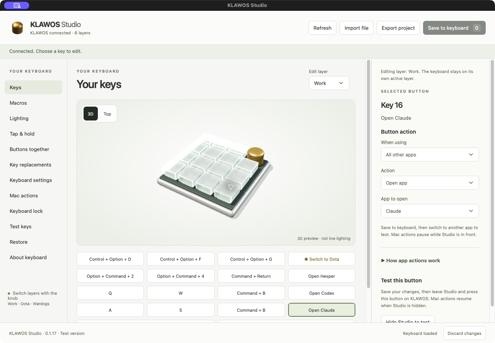
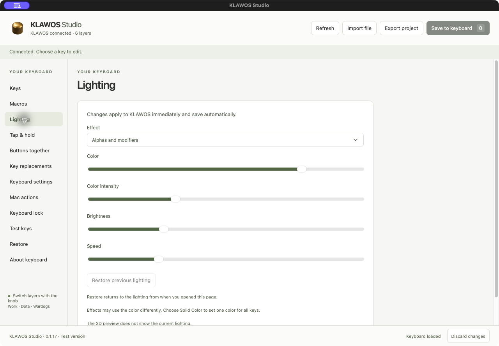
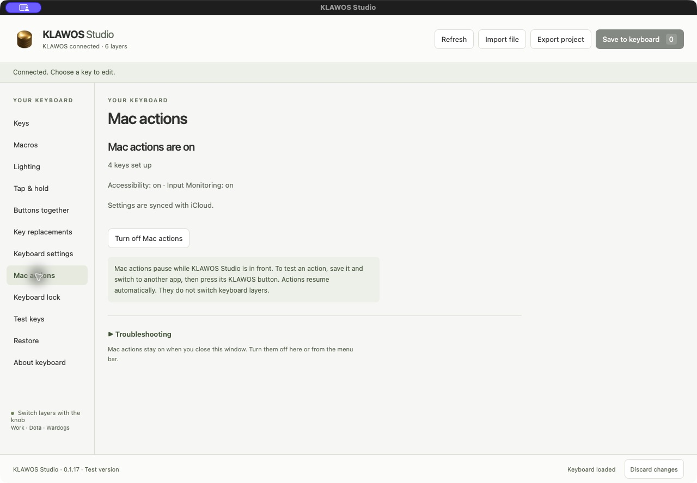
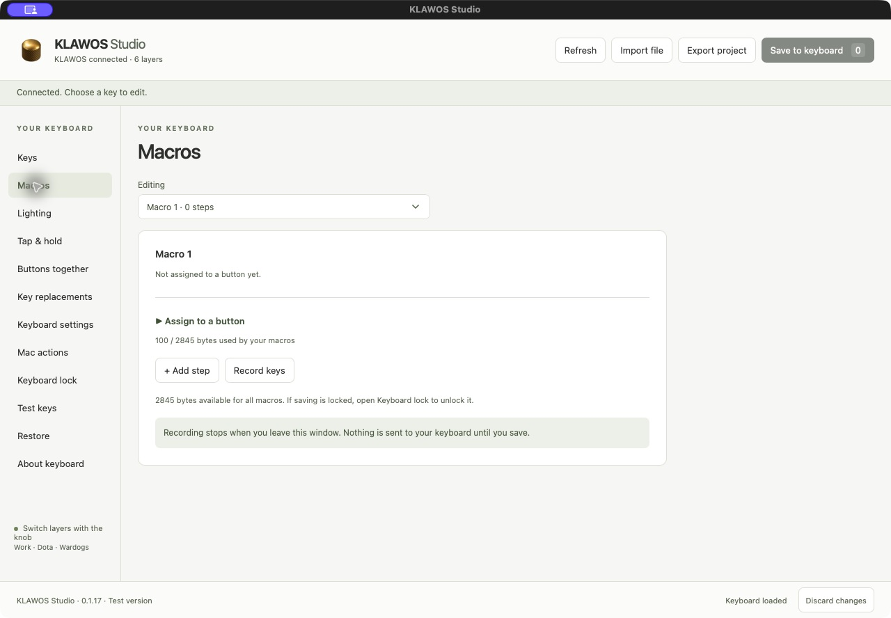
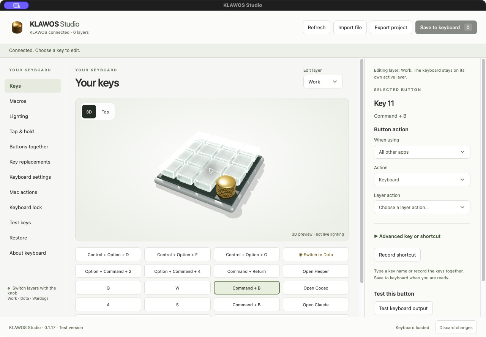

# KLAWOS Studio screenshots

Captured from the installed Mac app on 23 October 2026, after updating the board, logo and app icon to the low rounded gold knob. These are the actual app screens, with existing settings. Taking the screenshots did not save any new keyboard assignments or lighting values.

## Keys and shortcuts

Select a button to edit its action or record a shortcut. This example shows Command + B assigned to Key 11.

## Open an app

Assign a button to open an app or bring it to the front. Key 16 is set to Open Claude.

## Lighting

Choose an effect and adjust color, intensity, brightness and speed. Lighting controls act on the keyboard; the 3D illustration does not preview live LED colors.

## Mac actions and iCloud

See whether Mac actions are on, check permissions and view the sync status on this Mac.

## Macros

Record a sequence of keys, edit its steps and assign it to a button.

## Another board angle

The 3D view can rotate by dragging and zoom by scrolling. Here is the same board from one other angle.

